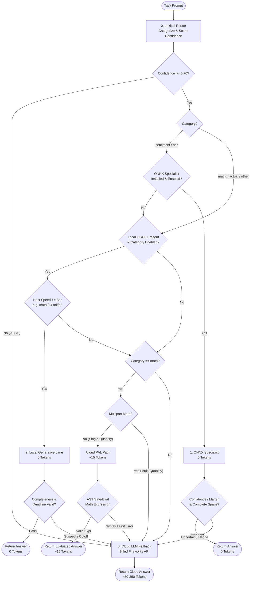
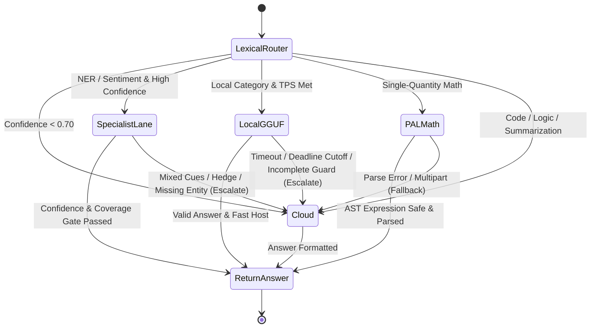

<div align="center">
  
  <p><strong>Hierarchical Multi-Lane Query Routing Architecture</strong></p>
</div>

---

# Architecture & Lane Guide

QueryLane organizes query answering into a hierarchy of processing **lanes**, ordered strictly by increasing token cost. The fundamental principle is **precision-first cost minimization**: spend 0 Fireworks tokens whenever deterministic rules, small ONNX classifiers, or calibrated local weights can produce a reliable answer, but **escalate on doubt** to protect the accuracy gate.



---

## The Four Processing Lanes

| Lane | Execution Engine | Token Cost | Typical Latency | Best Suited For |
|------|------------------|------------|-----------------|-----------------|
| **0. Rules & Stripping** | Regex & AST Normalizers | **0 tokens** | < 1 ms | Pre-filtering, instruction stripping, number normalization |
| **1. ONNX Specialists** | ONNX Runtime (CPU int8) | **0 tokens** | ~20–80 ms | High-confidence sentiment (`sst2`) and entity recognition (`ner`) |
| **2. Local GGUF** | llama-cpp-python (CPU) | **0 tokens** | ~2–15 s | Speed-calibrated factual and math when host clears the TPS bar |
| **3. Cloud Fallback** | Fireworks AI API | **Billed** | ~0.5–2 s | Uncertain queries, complex code debug/gen, logic, summarization |

---

## Detailed Lane Mechanics

### Lane 1: Zero-Token ONNX Specialists
Non-generative classifiers run locally on CPU with int8 quantization:
- **Sentiment (`models/sst2/model.onnx`)**: DistilBERT-base fine-tuned on SST-2.
  - *Gate*: Aggregates clause sentiment scores, checks sentiment-cue agreement, and detects hedging phrases or contrast conjunctions (*"but"*, *"although"*). If evidence is mixed or confidence < 0.97, it **escalates immediately** to cloud.
- **NER (`models/ner/model.onnx`)**: BERT-base-NER.
  - *Gate*: Reconciles 4-class model outputs (PER, ORG, LOC, MISC) with the 6-class task schema. Every capitalized token and date in the input must be accounted for. If any span is ambiguous or missing, it **escalates** to cloud.

### Lane 2: Local GGUF Lane
When enabled via `LOCAL_CATEGORIES`, QueryLane uses a compact quantized LLM (e.g., `Qwen2.5-3B-Instruct-Q4_K_M.gguf` or fine-tuned `1.5B`):
- **Warmup Calibration**: Measures host generation speed (tokens per second) before processing tasks.
- **Per-Category Speed Bars**: Math (0.4 tok/s), NER (0.9 tok/s), Factual (1.3 tok/s). If the host cannot clear the bar, the category automatically degrades to cloud without wasting time.
- **Deadline Guard**: Generative tasks switch to cloud when remaining time drops below `LOCAL_CUTOFF_SECONDS` (default: 150s).

### Lane 3: Cloud Fallback & PAL Math
When queries escalate or require high-capacity reasoning (code debugging, code generation, multi-step logic, abstractive summarization):
- **Cloud-PAL Math**: For single-quantity math word problems, the cloud model emits a minimal formula (`EXPR: 120 * (1 - 0.25) - 15 | UNIT: shirts`) consuming only ~15 completion tokens. QueryLane evaluates this safely on the host via Python AST parsing.
- **Terse Prompts**: Per-category system prompts are stripped of conversational preamble, and reasoning tokens are disabled (`reasoning_effort: none`) to achieve the absolute token floor.
- **Resilient Execution**: Equal-jitter exponential backoff, per-task budgets (75s), and automatic model fallback across `ALLOWED_MODELS`.

---

## Escalation State Diagram

Every cheap lane has an explicit contract: return an answer if and only if certainty is high, or return empty to escalate.



---

## Inspecting Decisions via CLI & Web

To inspect how QueryLane routes any query in real time:

```bash
# Using CLI
querylane-explain "Identify the founder: Steve Jobs started Apple in California."

# Or via python module
python -m agent.explain "Calculate 25 * 40 - 150"

# Launch interactive Web Demo
python -m agent.web_demo --port 8000
```
